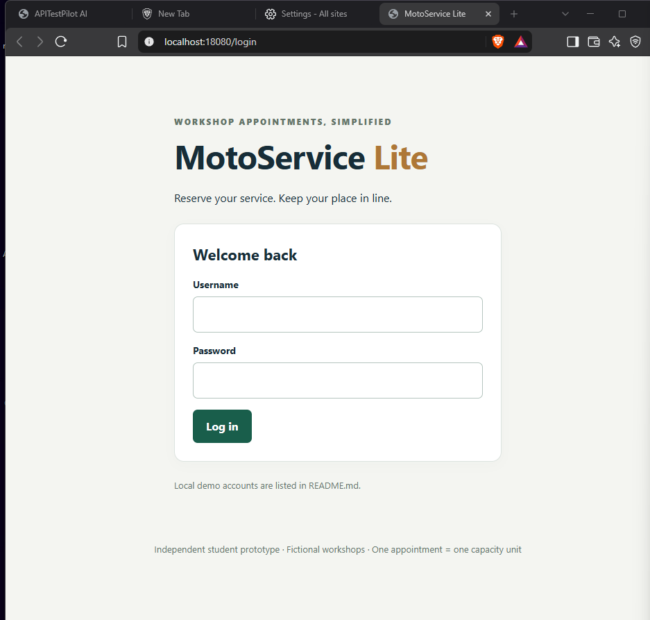
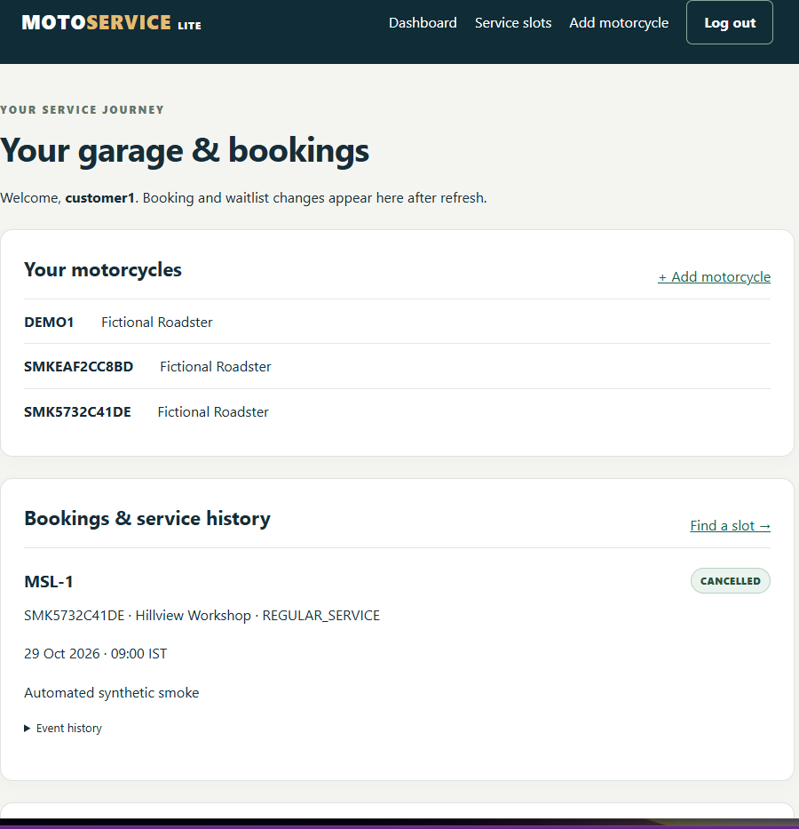
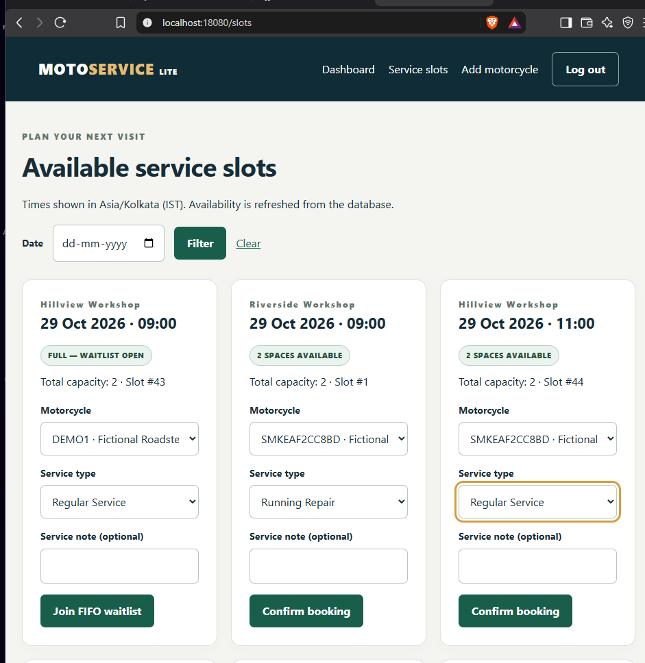
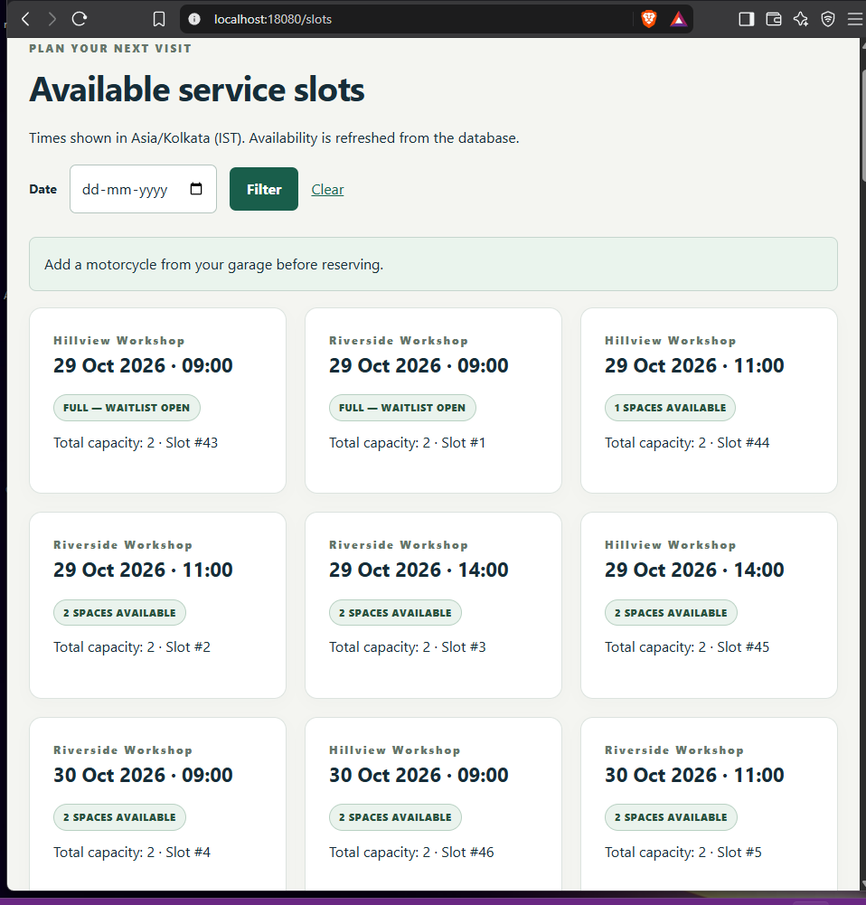
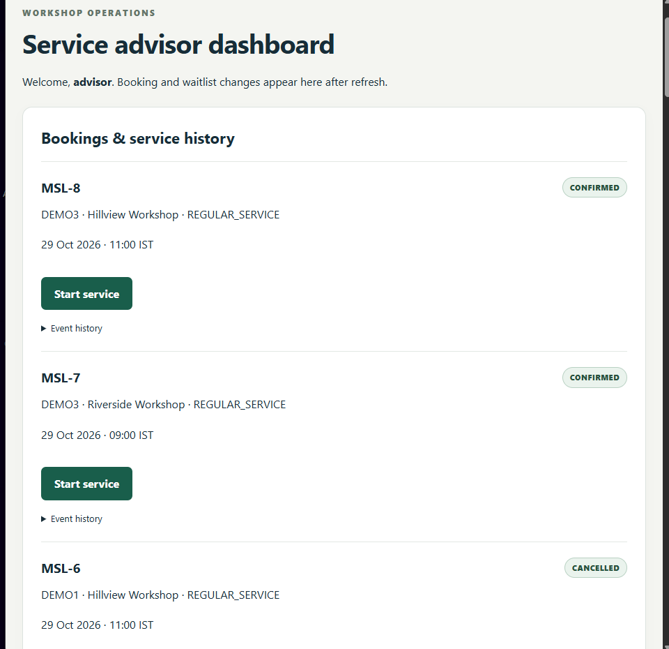
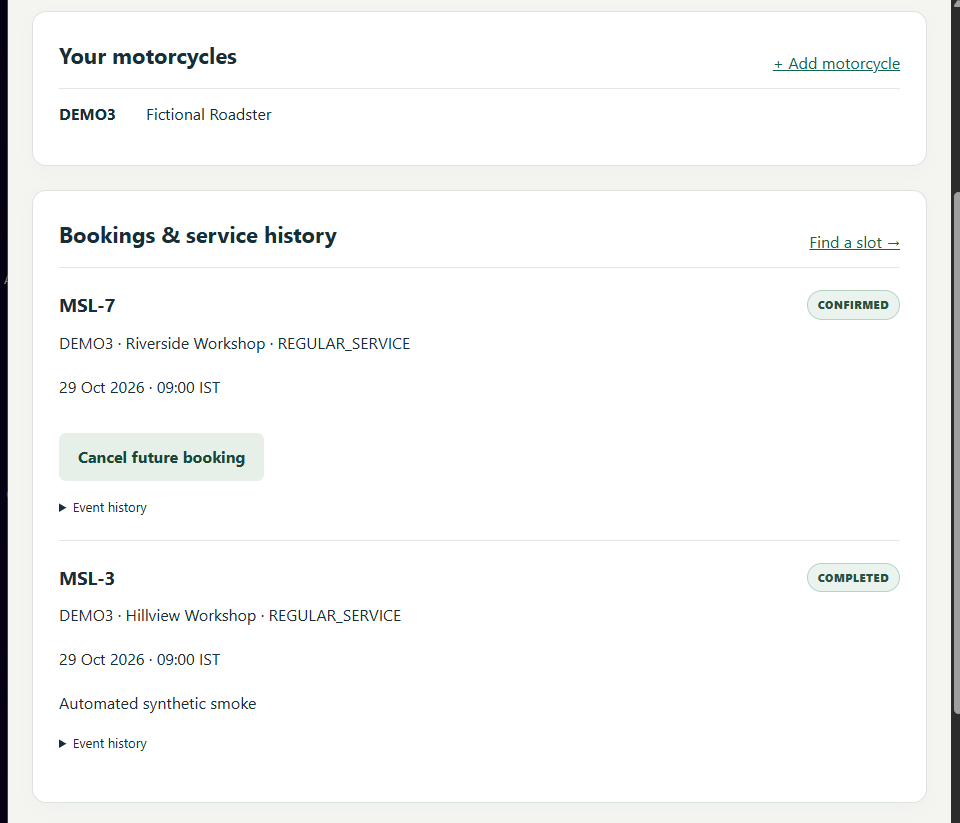
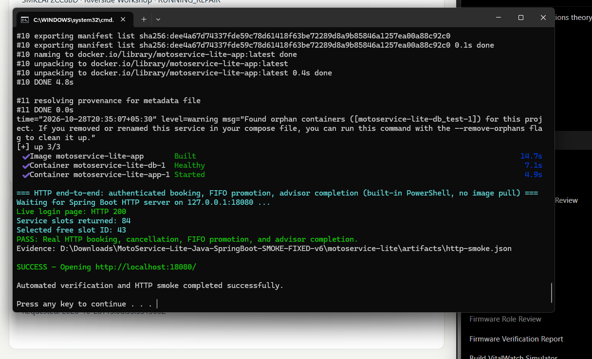
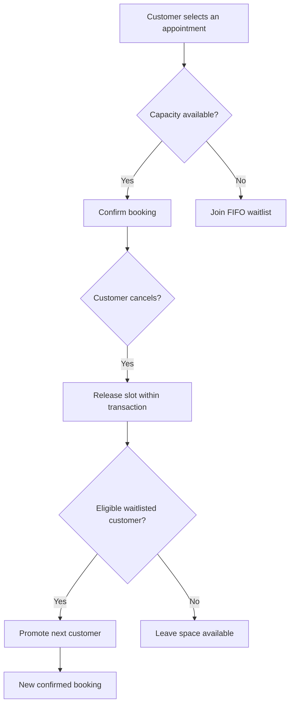
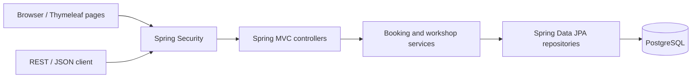

<div align="center">

# 🏍️ MotoService Lite

### Book smarter · Wait fairly · Never overbook

**An independent Java + Spring Boot motorcycle workshop booking system**  
Customers reserve appointments. Fully booked slots offer a fair waitlist. Cancellations automatically free a spot for the next eligible customer.

**Java 21** · **Spring Boot 3.5.16** · **PostgreSQL 16** · **Spring Security** · **Thymeleaf** · **Docker Compose** · **JUnit 5**

[See it working](#see-the-working-application) · [How it works](#how-it-works-in-plain-english) · [Test evidence](#what-was-tested) · [Run on Windows](#run-locally-on-windows-11)

</div>

> **Independent student project.** All motorcycles, customers and workshops are fictional. Not affiliated with or connected to Royal Enfield or any real service center. This is a local prototype, not a deployed commercial system.

## The everyday problem

Imagine that a workshop can service **two motorcycles at 9 AM**. Two customers book the spots, so the third customer joins a waiting list. If someone cancels, the open appointment might otherwise go unused.

**MotoService Lite handles this automatically:** it never confirms more bookings than a slot can hold, remembers the waiting order, and promotes the earliest eligible customer when a confirmed booking is cancelled.

## See the working application

These are **real screenshots of the application running locally on Windows with Docker and PostgreSQL**, captured during the user's verified demonstration. They show synthetic demo records, not real customer data.

| Login | Customer's garage & bookings |
|:--:|:--:|
|  |  |

| Service availability | Waitlist promotion |
|:--:|:--:|
|  |  |

| Service advisor | Completed service history |
|:--:|:--:|
|  |  |

<details>
<summary><b>View successful live HTTP smoke test</b></summary>



</details>

## How it works in plain English

1. **Choose an appointment.** A customer sees available times at fictional service centers and selects a motorcycle.
2. **Make a safe reservation.** The backend checks availability inside a PostgreSQL transaction to prevent simultaneous customers from overbooking a slot.
3. **Join a fair line.** When a slot is full, the customer can join a *first-in, first-out (FIFO)* waitlist.
4. **Recover a cancellation.** When a confirmed customer cancels, the first eligible waitlisted customer receives the freed space automatically.
5. **Finish the service.** A service advisor advances a booking through `CONFIRMED → IN_SERVICE → COMPLETED`. Customers can review the history.



## What makes it a software engineering project?

| Capability | The technical idea | Why it matters |
|---|---|---|
| No overbooking | PostgreSQL row locking and Spring `@Transactional` | Concurrent requests cannot silently exceed slot capacity |
| Fair waitlists | Persisted FIFO ordering by request time and ID | Cancellations are reassigned predictably |
| Account protection | Spring Security, BCrypt and role restrictions | Customers access their own records; advisors manage service states |
| Reliable API | Spring MVC, validation, JSON and REST endpoints | The browser and API share consistent business rules |
| Data integrity | JPA repositories, constraints and Flyway migration | Bookings, motorcycles and event history remain in a relational database |
| Quality checks | JUnit, MVC tests and PostgreSQL integration tests | Important cases are checked automatically |

### Simple architecture



**Design choice:** one Spring Boot application is enough for this small business problem. No AI, Kafka, Kubernetes, or unnecessary microservices are required.

For more detail see [architecture](docs/architecture.md), [API reference](docs/api-examples.md) and [Java interview explanations](docs/java-concepts-for-interviews.md).

## What was tested?

The project owner supplied actual Windows/Docker console evidence from **28 October 2026**:

| Verification | Observed result |
|---|---|
| Java unit and MVC tests | **31 passed** |
| PostgreSQL integration suite | **34 passed** |
| Concurrency scenarios | **5 passed** (included in the 34) |
| Security scenarios | **13 passed** (included in the 34) |
| **Automated test total** | **65 passed, 0 failures** |
| Live browser login | Working |
| Live authenticated HTTP flow | **PASS**: booking → cancellation → FIFO promotion → advisor completion |

**Important:** These are local, synthetic-data results; the application has not been validated against real customer traffic or production uptime. Some bundled `docs/evidence/` reports are from earlier partial-verification runs; the later successful live evidence is shown in the screenshot above. The archived source tests can be rerun using `RUN_ALL.cmd`.

## Run locally on Windows 11

**Required:** Docker Desktop with Linux containers enabled. The provided launcher uses Docker to run the build and verification, so you do not need to install Maven manually.

1. Download or clone this repository.
2. Start **Docker Desktop** and confirm the engine is running.
3. Open the `motoservice-lite` directory.
4. Double-click **`RUN_ALL.cmd`**.
5. When verification succeeds, visit **http://localhost:18080/login**.

**Local demo accounts** (not intended for public deployment):

| Role | Username | Password |
|---|---|---|
| Customer | `customer1` | `DemoRide21!` |
| Service advisor | `advisor` | `DemoAdvisor21!` |

The example data includes other seeded demo customers; consult the application seed configuration for their credentials.

**Ports:** website `18080`, PostgreSQL mapped to localhost `55432` (internally `5432`). The app and database run in Docker. The launcher executes tests before performing its browser/API workflow check, and writes local output under `artifacts/`.

If port `18080` or `55432` is occupied by another project, change the host-side mapping in `compose.yaml` and update the launcher URL accordingly. Never publish secrets from `.env`.

**Manual Docker startup** (advanced):

```powershell
docker compose --profile full up --build -d
```

If you use this manual command without building the JAR first, follow [Windows setup](docs/windows-setup.md) for the correct build prerequisite. The recommended, tested route is `RUN_ALL.cmd`.

## Project structure

```text
motoservice-lite/
├── src/main/java/com/motoservice/   # Java controllers, services, entities, repositories
├── src/main/resources/              # Thymeleaf pages, CSS, Flyway migrations
├── src/test/                        # Unit, MVC and PostgreSQL integration tests
├── screenshots/                     # Real local screenshots used on this page
├── docs/                            # Research, design, tests and interview guide
├── scripts/                         # Windows automation and evaluation helpers
├── .github/workflows/ci.yml         # GitHub Actions workflow definition
├── pom.xml                          # Maven dependencies and test configuration
├── compose.yaml                     # PostgreSQL and application services
└── RUN_ALL.cmd                      # One-click Windows verification launcher
```

## Research and limits

This prototype applies established appointment scheduling and resource-allocation ideas in a practical Java application. It **does not claim a novel algorithm** or prove that its simple FIFO rule is optimal. Read the [research foundation](docs/research-foundation.md) and [evaluation method](docs/evaluation.md).

The model deliberately assumes **one appointment uses one unit of workshop capacity**. Repair duration, actual technicians, spare parts, payments, no-show prediction, and real service-center integrations are outside its scope.

## Interview preparation

- [20 project interview answers](docs/interview-guide.md)
- [Java, OOP and DSA concepts explained](docs/java-concepts-for-interviews.md)
- [Test matrix](docs/test-matrix.md)
- [Resume evidence](docs/resume-evidence.md)

---

**Built as a final-year software engineering portfolio project by [Mohammad Yusuf K A](https://github.com/yusufthecoder474).** See [LICENSE](LICENSE).


## Cloud and platform extension

This branch adds secure liveness/readiness probes, a non-root image, isolated Docker restart/persistence verification, local kind manifests, Terraform and a manually gated Azure OIDC workflow. **Azure is not deployed.** Existing screenshots and local launcher above are preserved.

Start with the [Windows/WSL2 platform guide](docs/PLATFORM_GUIDE.md), then inspect [actual verification evidence](evidence/PG_CLOUD_UPGRADE_VERIFICATION.md), [Terraform](docs/terraform.md), [Azure deployment gates](docs/AZURE_DEPLOYMENT.md), [low-level design](docs/LOW_LEVEL_DESIGN.md), and [independent Agile delivery](docs/AGILE_DELIVERY.md). Use `VERIFY_PLATFORM.cmd` for the new isolated local verifier; `RUN_ALL.cmd` remains the original demonstration.
