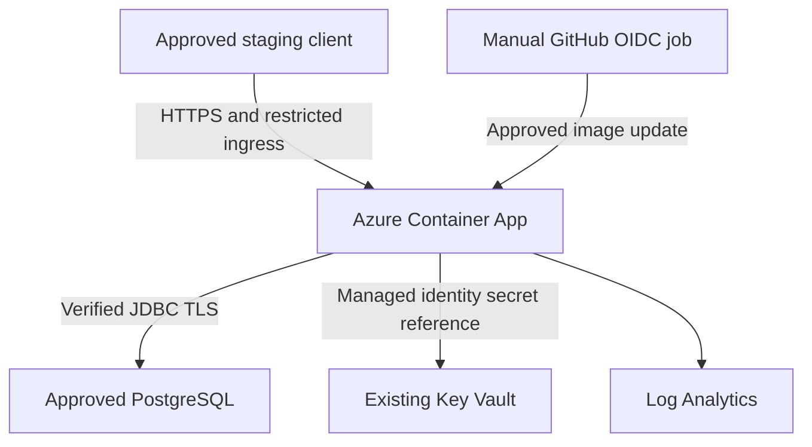

# Low-level design

## Existing component contracts (preserved)

| Component | Inputs / outputs | Responsibility |
|---|---|---|
| `ApiController` | Authenticated principal + validated request DTO → JSON view DTO | REST transport and status codes |
| `WebController` | Form fields + principal → Thymeleaf model/redirect | Browser workflow and validation feedback |
| `WorkshopService` | Username/IDs/request DTO → domain views | Ownership, capacity, transitions, waitlist promotion; transaction boundary |
| `SlotRepository.lockById` | Slot ID → locked `ServiceSlot` | JPA `PESSIMISTIC_WRITE`, serializes changes to one slot |
| Booking / waitlist / event repositories | Entities, slot/customer IDs → persistent records | Queries, FIFO ordering, occupancy and event history |
| `SecurityConfig` | Session/Basic credentials and CSRF → authorized request | BCrypt, customer/advisor rules, precise anonymous probe access |
| `CloudSafetyGuard` (new) | Effective cloud configuration and username lookup → startup success/failure | Reject demo mode/accounts and unverifiable JDBC TLS |
| Actuator health groups (new) | GET probe → status only | Process liveness versus DB-aware readiness |

`WorkshopService` defaults to read-only transactions and marks mutations transactional. A booking acquires the slot lock, checks motorcycle ownership/duplicates and counts non-cancelled bookings before insert. Cancellation and eligible FIFO promotion run in one transaction under the same slot lock; readers cannot observe a committed half-promotion. Database constraints provide additional referential/uniqueness protection. FIFO uses requested timestamp then ID, with ineligible entries handled by existing business logic. Lock timeout is 15 seconds. These are PostgreSQL semantics; H2 is not substituted for concurrency verification.

```mermaid
sequenceDiagram
  participant C as Customer
  participant A as API / Web controller
  participant S as WorkshopService
  participant P as PostgreSQL
  C->>A: Cancel owned booking + CSRF
  A->>S: cancel(username, bookingId)
  S->>P: Begin transaction; lock slot
  S->>P: Cancel booking; select eligible FIFO entry
  S->>P: Insert promoted booking and history
  S->>P: Mark queue entry promoted; commit
  S-->>A: Updated booking view
  A-->>C: JSON or redirect
```

## Routes

All `/api/**` routes require authentication. Writes additionally require CSRF. `/api/advisor/**` and `/advisor/**` require `SERVICE_ADVISOR`; the service also enforces customer ownership/role rules.

| Method | Route | Effect |
|---|---|---|
| GET | `/api/csrf` | Session-bound CSRF token |
| GET | `/api/centers`, `/api/slots`, `/api/slots/{id}` | Available workshops/slots |
| GET / POST | `/api/motorcycles` | Own motorcycles / register motorcycle |
| GET / POST | `/api/bookings` | Own bookings / reserve slot |
| POST | `/api/bookings/{id}/cancel` | Cancel and promote eligible FIFO entry atomically |
| GET / POST | `/api/waitlist` | Own queue entries / join full slot queue |
| POST | `/api/waitlist/{id}/withdraw` | Withdraw owned queue entry |
| PATCH | `/api/advisor/bookings/{id}/status` | Advisor status transition |
| GET | `/login`, `/style.css` | Public login and stylesheet |
| GET | `/actuator/health/liveness`, `/actuator/health/readiness` | Anonymous status-only probes |

Other Actuator routes are denied, including general health, env and metrics. Metrics can be inspected through platform monitoring rather than exposing management endpoints. Browser routes reuse the same service rather than duplicating rules.

## Data model and deployment

Users own motorcycles; centers contain slots; bookings link user, motorcycle and slot; waitlist entries optionally reference a promoted booking; booking events form status history. `V1__schema.sql` is unchanged, with partial unique indexes for active bookings/waitlist entries. The upgrade adds no business tables and no destructive migration.



This is the intended Azure topology, **not deployed evidence**. Terraform owns the app group, workspace, environment and app; DB, identity, Key Vault, state and any private network are separately approved dependencies. Local kind uses ClusterIP app/DB services and loopback port-forward; its PostgreSQL `emptyDir` is disposable. No AKS resources or HA claim exists.

JAR → non-root image → readiness-gated runtime. The readiness DB check times out through Hikari; process liveness excludes external dependency availability. The server allows 30 seconds to drain requests; orchestrator termination allows 40 seconds. Cloud session cookies are Secure; TLS terminates at trusted ACA ingress and forwarded headers are honored. Do not expose the container directly to untrusted clients who could forge forwarding headers. In-memory sessions and a single cloud replica are deliberate portfolio limitations.
