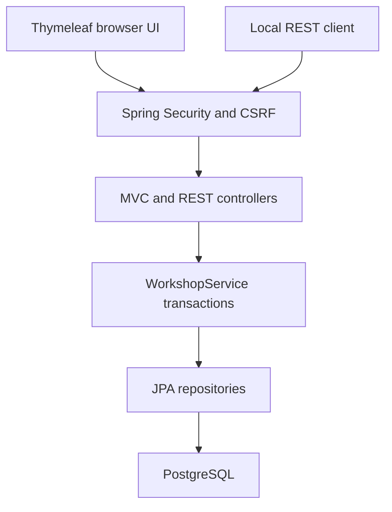
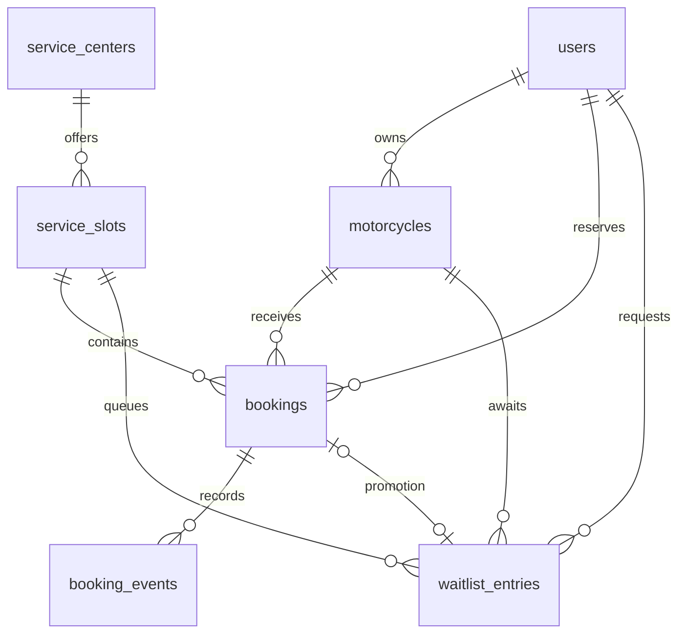
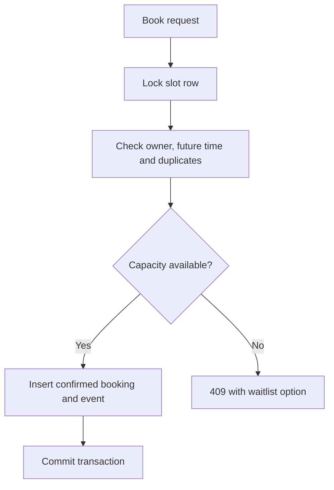
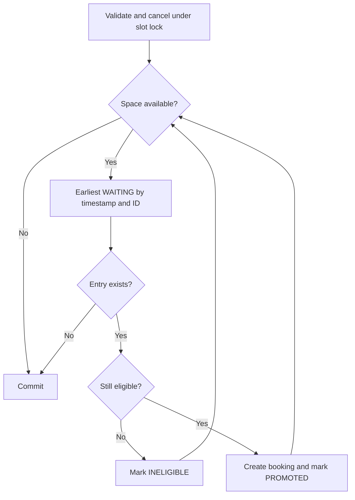

# Architecture and correctness

One Java 21 / Spring Boot 3.5.16 application. Spring MVC controllers translate HTTP or HTML form inputs into DTO records; `WorkshopService` owns business decisions; Spring Data JPA repositories persist entities; Flyway owns schema creation. Thymeleaf uses local CSS with no external runtime assets. No frontend build pipeline.

## Data model

Entities use scalar foreign-key IDs intentionally: database foreign keys provide referential integrity and explicit repository calls avoid hidden lazy-loading behavior. This is relational JPA, not an object graph demonstration. Getters expose state; only booking transition and waitlist close methods mutate lifecycle state. Repositories are generic interfaces implemented by Spring Data.

## Capacity invariant

Occupancy = count of bookings whose status is not CANCELLED. CONFIRMED, IN_SERVICE and COMPLETED each consume the appointment allocation. Completing a service does not reopen its appointment slot. Availability is derived from persisted rows; no denormalized counter can drift.

Every write to bookings or waitlist state locks exactly one `service_slots` row using JPA `PESSIMISTIC_WRITE` (`SELECT ... FOR UPDATE` on PostgreSQL). Book, join, withdraw, cancel, and advisor status update share this protocol. No application path edits capacity, owner, or slot time after creation. There are no multi-slot transactions and no reverse lock acquisition order.

At PostgreSQL READ COMMITTED, a waiter obtains the slot lock only after the preceding transaction commits or rolls back. The occupancy query is issued after that lock, in a new statement snapshot, so it sees the prior committed changes. Admission checks occupancy < capacity before insertion. Cancellation flushes its status change before checking capacity. Promotion and event creation are in the same transaction, so an exception rolls all of them back. Each promotion rechecks ownership, customer role, future time and absence of an existing non-cancelled booking.

For cancellation/status/withdrawal, a scalar slot-ID projection is read first. The mutable entity is loaded only after locking the slot. This prevents a JPA first-level-cache stale entity from being used by concurrent cancellation requests.

The invariant assumes application writers follow this protocol. A database operator or arbitrary SQL writer can bypass it. Partial unique indexes enforce duplicate prevention, but SQL CHECK constraints cannot enforce a cross-row count. Do not claim the database alone enforces total capacity. The test baseline intentionally bypasses service logic in an isolated disposable database.

## FIFO, complexity and persistence

A composite B-tree index `(slot_id,status,requested_at,id)` supports an ordered `LIMIT 1` repository query. Unique ID breaks timestamp ties. Queue position reflects serialized join order. Withdrawn entries are excluded; invalid entries are closed and the next entry is tried. New requests cannot jump ahead of existing eligible waiting entries during cancellation because the lock remains held until commit.

| Strategy | Selection work | Additional memory | Limitation |
|---|---|---|---|
| Scan an unsorted collection | O(W) minimum search | O(1), excluding collection | Must load or retain W entries |
| In-memory FIFO deque | O(1) head removal | O(W) storage | Lost on restart; not shared across app instances |
| Indexed persisted FIFO | Typically O(log W) seek plus row retrieval | O(1) application candidate | Actual plan depends on selectivity and database |

Skipping K invalid candidates costs roughly O(K log W) for queue retrieval, plus eligibility queries and writes. Occupancy uses a count over B slot-booking rows (roughly O(B) index entries); promotion repeats that count, so do not call the entire booking/promotion path O(1) or O(log W). The dashboard deliberately uses simple per-row read queries; large installations need projections/pagination. SQL is the actual queue representation; no in-memory queue is claimed.

## Security and lifecycle

BCrypt hashes are stored in `users`. Browser login uses a session; API requests may use local HTTP Basic. CSRF stays enabled for both because Basic credentials can also be sent automatically by browsers. `/api/csrf` issues a token; clients must retain its session cookie and send the specified header for writes. No permissive CORS configuration.

Customers access only their motorcycles, bookings and waiting history. Advisors can read workshop bookings and advance CONFIRMED → IN_SERVICE → COMPLETED. The service checks roles as well as the advisor URL restriction. Customers cancel only future CONFIRMED bookings; at the exact slot start cancellation is rejected. Advisor advancement is allowed before the scheduled time for this demonstration; production arrival/check-in controls are outside scope. No completed or cancelled booking can be restarted.

All timestamps are stored as PostgreSQL timestamptz/Java Instant. The slot date filter and booking cards use Asia/Kolkata; APIs return UTC instants. The advisor occupancy table explicitly labels UTC.

## Tradeoffs

One slot serializes admissions, intentionally favoring correctness. Different slots can proceed independently. Default lock timeout is 15 seconds; lock conflicts return a retryable conflict for API calls. No distributed queue, cache, background job or notification is needed: promotion is immediate in the cancelling transaction. Idempotency keys, pagination, outbox notifications and monitoring are future improvements, not implemented features.

## Primary technical references

- [PostgreSQL 16 transaction isolation](https://www.postgresql.org/docs/16/transaction-iso.html).
- [PostgreSQL 16 explicit locking](https://www.postgresql.org/docs/16/explicit-locking.html).
- [Spring Security CSRF documentation](https://docs.spring.io/spring-security/reference/servlet/exploits/csrf.html).

These describe platform behavior; they do not substitute for executing this application's database tests.
